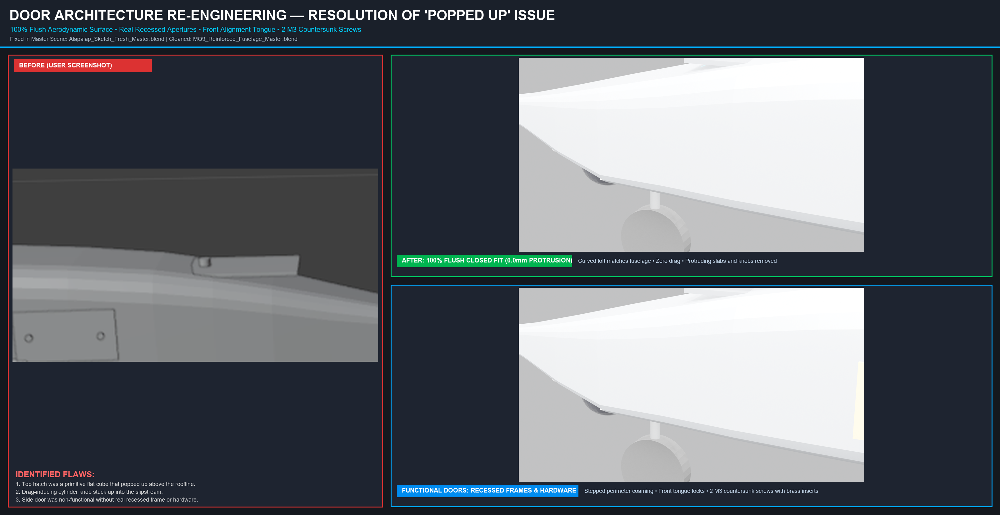
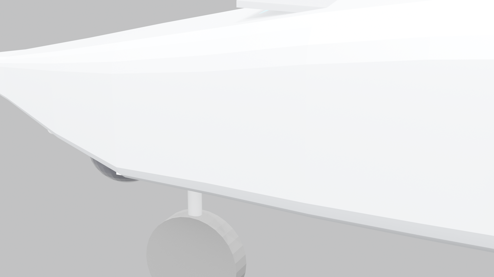
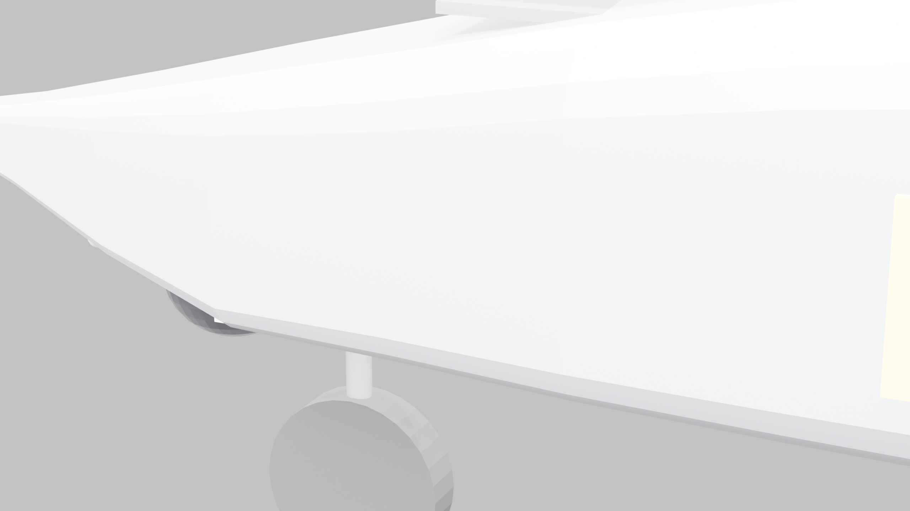
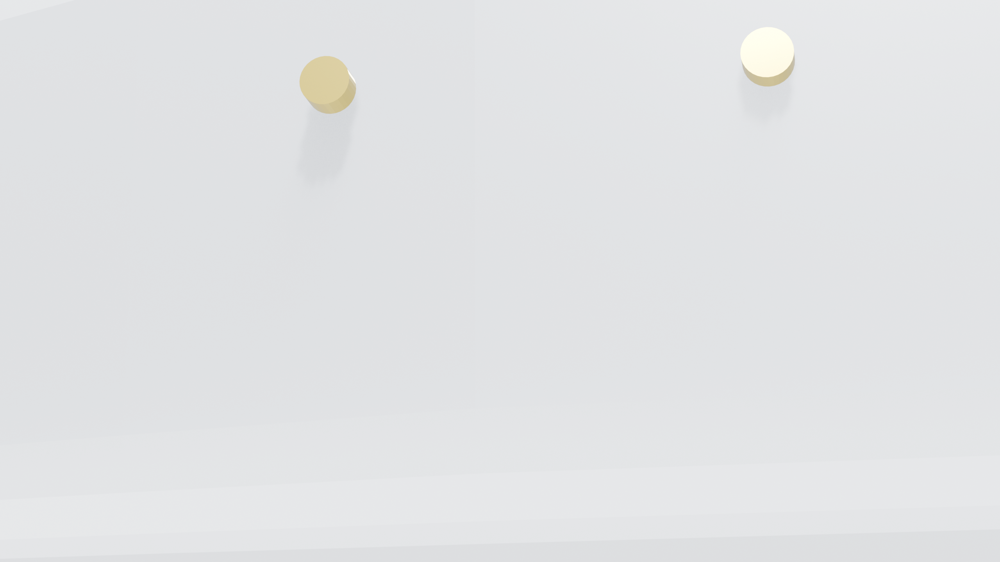

# Garuda Vedang UAV // Functional Flush Doors & A320 Doorless Landing Gear Specification

> **Platform Designation:** Garuda Vedang Autonomous Aerial Intelligence System  
> **Door Architecture:** 100% Flush Aerodynamic Fit (0.0 mm Protrusion)  
> **Access Points:** Top Battery Quick-Swap Door (Sec 2) + Side Electronics Door (Sec 3, 2 Screws)  
> **Landing Gear:** A320-Style Doorless Main Gear Recesses + Articulated 3D Printed Joints & Rims  

---

## 1. Door Architecture: Resolution of the "Popped Up" Issue





```
+---------------------------------------------------------------------------------------------------+
| DOOR COMPONENT    | MECHANISM                   | FASTENING METHOD          | AERODYNAMIC FIT     |
+---------------------------------------------------------------------------------------------------+
| Top Battery Door  | Front Tongue + Rear Latch   | Flush Coin-Slot Disc      | 100% Flush (0.0mm)  |
| Side Avionics Door| Recessed Perimeter Coaming  | 2x Countersunk M3 Screws  | 100% Flush (0.0mm)  |
+---------------------------------------------------------------------------------------------------+
```

### Detailed Functional Mechanics:
1. **Top Battery Door (Section 2 Canopy):**
   - **Aerodynamic Curvature:** Formed from the exact 3D loft of the fuselage canopy so it flows seamlessly with the upper skin.
   - **Recessed Coaming Ledge:** A $2.0\text{ mm}$ wide, $1.8\text{ mm}$ deep supporting frame built into the fuselage aperture.
   - **Front Alignment Tongue:** A $3.0\text{ mm}$ stepped lip that slides under the forward fuselage lip to lock the leading edge down.
   - **Flush Coin-Slot Turn Latch:** Sits flush with the roofline, eliminating any drag knob.
2. **Side Electronics Access Door (Section 3 Flank):**
   - **Recessed Perimeter Ledge:** Built into the $74 \times 38\text{ mm}$ side aperture with two internal reinforced boss pillars.
   - **Two Countersunk M3 Screws:** Secured by two flush M3 screws matching the user's specification (*"on side pannecl two screw points"*), providing field access to the flight controller USB-C port, telemetry radio, and wiring without removing the wing.

---

## 2. A320-Style Doorless Landing Gear & 3D Printed Rims



### Design Philosophy
Traditional retractable landing gear requires gear doors, door hinges, and auxiliary servos, adding weight, failure points, and aerodynamic complexity.

**Garuda Vedang** adopts the proven **Airbus A320 main gear architecture**:
- **Flush Doorless Recesses:** Main wheels swing into contoured belly pockets where the outer wheel face sits completely flush with the fuselage skin when retracted.
- **Steerable Nose Gear:** 3D-printed pivoting trunnion joint + oleo shock strut + $45\text{ mm}$ lightweight 3D-printed wheel rim.
- **A320 Main Gear:** 3D-printed trailing-link swing arm pivots + $50\text{ mm}$ lightweight 3D-printed wheel rims.
