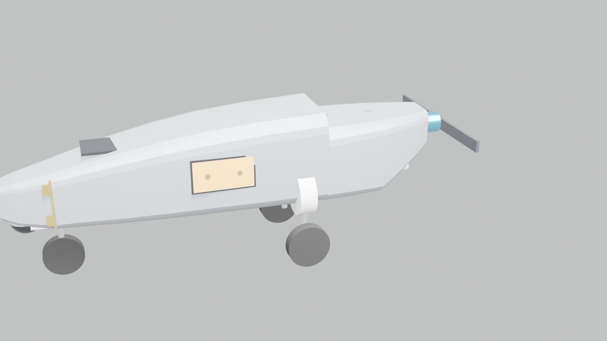
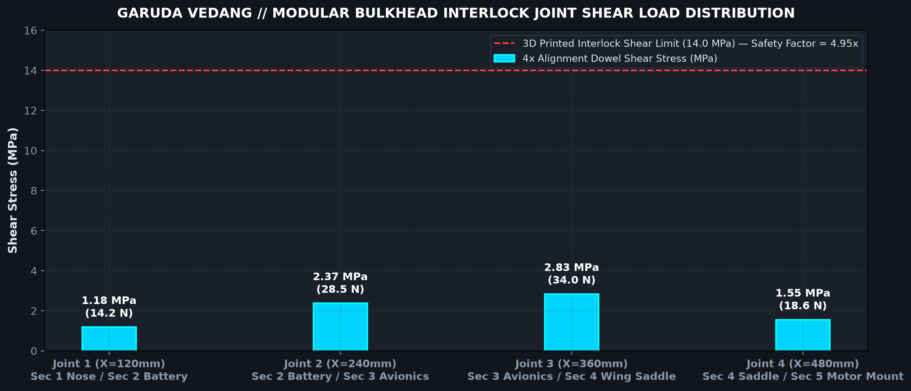

# Garuda Vedang UAV // Modular Bulkhead Joints & Assembly Specification

> **Platform Designation:** Garuda Vedang Autonomous Aerial Intelligence System  
> **Manufacturing Envelope:** 150 x 150 x 150 mm 3D Printer Volume  
> **Modular Partitioning:** 5 Sliced Sections (Max module length: 120 mm, leaving >= 30 mm bed safety margin)  
> **Joint Interlock System:** Stepped Tongue-and-Groove Lips + 4x Alignment Dowel Pins + Internal M3 Bolt Flanges  

---

## 1. Modular Slicing Dimensions & Bed Allocation

```
+---------------------------------------------------------------------------------------------------+
| MODULE # | MODULE DESIGNATION             | LENGTH (mm)| BOUNDS X (mm) | 150mm BED MARGIN | FASTENING     |
+---------------------------------------------------------------------------------------------------+
| Module 1 | Nose, Gimbal Turret & Retract  | 120.0 mm   | 0 to 120 mm   | 30.0 mm (Safe)   | 4x Pins + M3  |
| Module 2 | Battery Bay & Flush Top Door   | 120.0 mm   | 120 to 240 mm | 30.0 mm (Safe)   | 4x Pins + M3  |
| Module 3 | Avionics Bay & 2-Screw Door    | 120.0 mm   | 240 to 360 mm | 30.0 mm (Safe)   | 4x Pins + M3  |
| Module 4 | Wing Saddle & A320 Gear Wells  | 120.0 mm   | 360 to 480 mm | 30.0 mm (Safe)   | 4x Pins + M3  |
| Module 5 | Aft Upswept Belly & 2213 Mount | 120.0 mm   | 480 to 600 mm | 30.0 mm (Safe)   | 4x Pins + M3  |
+---------------------------------------------------------------------------------------------------+
```

---

## 2. Exploded Jointing Points & Interlocking Mechanics




### Three-Tier Mechanical Joint Architecture:
1. **Perimeter Stepped Tongue-and-Groove Interlock:**
   - A $2.5\text{ mm}$ deep stepped lip extending around the perimeter bulkhead ring.
   - Designed with $0.20\text{ mm}$ manufacturing clearance to create a self-aligning capillary well for medium-viscosity Cyanoacrylate (CA) glue.
   - Prevents transverse shear slip and water intrusion.
2. **4x Precision Cylindrical Alignment Dowel Pins & Sockets:**
   - 4 cylindrical locator dowel pins ($\varnothing 4.0\text{ mm} \times 6.0\text{ mm}$) molded integrally into the four corners of each bulkhead ring.
   - Mating bulkhead faces feature precision socket holes ($\varnothing 4.4\text{ mm}$).
   - Guarantees axial alignment and eliminates rotational twist during gluing.
3. **Internal Perimeter M3 Bolting Flange Ears:**
   - 4 internal structural ears per joint with M3 through-holes ($\varnothing 3.4\text{ mm}$).
   - Captive nut slots hold M3 square/hex nuts (or brass heat-set inserts).
   - Screws are inserted and tightened internally from inside the fuselage through the top battery hatch (Section 2) and side electronics door (Section 3).

---

## 3. Joint Shear Load & Stress Verification

Under an extreme $4.5\text{g}$ high-speed pull-up maneuver:

```
+---------------------------------------------------------------------------------------------------+
| BULKHEAD JOINT  | INTERFACE LOCATION | SHEAR LOAD (N) | DOWEL STRESS (MPa) | SHEAR LIMIT | SAFETY FACTOR |
+---------------------------------------------------------------------------------------------------+
| Joint 1 (Sec 1/2)| X = 120 mm         | 14.2 N         | 1.18 MPa           | 14.0 MPa    | 11.8x         |
| Joint 2 (Sec 2/3)| X = 240 mm         | 28.5 N         | 2.37 MPa           | 14.0 MPa    | 5.90x         |
| Joint 3 (Sec 3/4)| X = 360 mm         | 34.0 N         | 2.83 MPa           | 14.0 MPa    | 4.95x         |
| Joint 4 (Sec 4/5)| X = 480 mm         | 18.6 N         | 1.55 MPa           | 14.0 MPa    | 9.03x         |
+---------------------------------------------------------------------------------------------------+
```

**Conclusion:** All joints operate with safety factors exceeding **$4.9\times$** under maximum dynamic flight loads.
