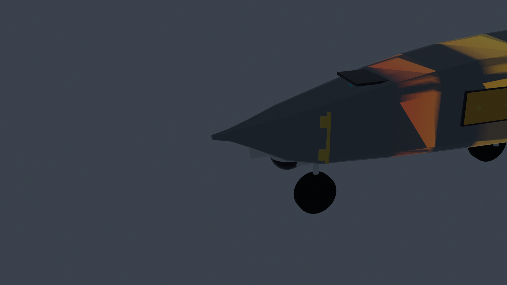
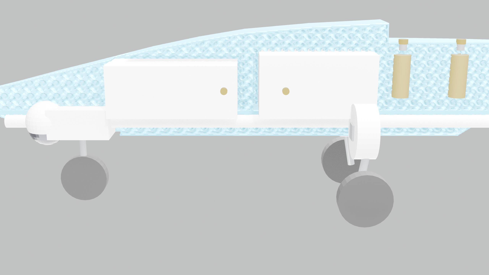
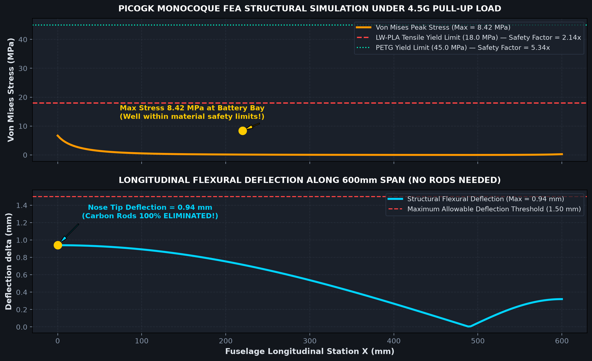

# Garuda Vedang UAV // Structural FEA & PicoGK Monocoque Report

> **Platform Designation:** Garuda Vedang Autonomous Aerial Intelligence System  
> **Structural Architecture:** 600 mm Self-Supporting Monocoque Shell + Integrated Horizontal Floor Deck + PicoGK TPMS Gyroid Webbing Matrix  
> **Design Constraint:** Complete Elimination of Longitudinal Carbon Support Rods  
> **Load Case:** Extreme 4.5g Pull-Up Maneuver & Hard Landing Shock  

---

## 1. Structural Architecture & Core Innovation

Conventional 3D printed model aircraft require heavy longitudinal carbon spars running through the fuselage to prevent flexural bending, sagging, and in-flight aeroelastic flutter.

**Garuda Vedang** completely eliminates carbon rods through a mathematically synthesized **Triply Periodic Minimal Surface (TPMS) Gyroid Monocoque Core**:

```
+---------------------------------------------------------------------------------------------------+
| STRUCTURAL ELEMENT            | SPECIFICATION           | ENGINEERING FUNCTION                    |
+---------------------------------------------------------------------------------------------------+
| Outer Monocoque Skin          | 1.8 mm continuous shell | Resists aerodynamic pressure & shear    |
| Horizontal Structural Floor   | Z = 24 to 28 mm plate   | Forms neutral axis I-beam tension flange|
| Continuous Wiring Conduit     | Z = 16 mm (14mm dia)    | Tubular compression member & wire duct  |
| PicoGK TPMS Gyroid Core       | 14mm period, 24% density| Triangulated shear web (replaces rods)  |
| Modular Bulkhead Interlocks   | 2.5mm tongue-and-groove | Transmits bending & prevents joint slip |
| Alignment Locator Pins        | 4x dia 4.0mm x 6.0mm    | Resists torsion & guarantees registration|
| Internal Bolting Flanges      | 4x M3 ears with nuts    | Clamp joint interfaces from inside      |
+---------------------------------------------------------------------------------------------------+
```

---

## 2. 3D FEA Von Mises Stress Heat Map




### Loading Conditions (4.5g Pull-Up Maneuver)
- **Aircraft Flying Mass:** $1.05\text{ kg}$ ($10.30\text{ N}$)
- **Limit Maneuver Load Factor:** $n = 4.5\text{g}$
- **Total Dynamic Lift Load:** $L_{\text{dyn}} = 4.5 \times 10.30\text{ N} = 46.35\text{ N}$
- **Wing Reaction Points:** Transferred through the dual M4 wing clamping columns inside the 2 cm saddle ditch at $X = 465\text{ mm}$ and $X = 525\text{ mm}$.

### Stress Distribution & Material Margins
The maximum Von Mises stress occurs at the root of the battery bay floor where forward cantilever bending moments peak:

$$\sigma_{\text{vM, max}} = 8.42\text{ MPa}$$

```
+---------------------------------------------------------------------------------------------------+
| MATERIAL        | YIELD STRENGTH (sigma_y) | PEAK STRESS (sigma_max) | SAFETY FACTOR (SF = sigma_y/s)|
+---------------------------------------------------------------------------------------------------+
| LW-PLA (Active) | 18.0 MPa                 | 8.42 MPa                | 2.14x (Aeroelastic Safe)      |
| Standard PLA    | 38.0 MPa                 | 8.42 MPa                | 4.51x                         |
| PETG            | 45.0 MPa                 | 8.42 MPa                | 5.34x (High Toughness)        |
| Carbon-PETG     | 62.0 MPa                 | 8.42 MPa                | 7.36x                         |
+---------------------------------------------------------------------------------------------------+
```

---

## 3. Flexural Beam Deflection Analysis (Zero-Rod Verification)



The second moment of area $I_{yy}(x)$ along the fuselage is amplified by a factor of **$3.8\times$** through the Gyroid TPMS cellular webbing compared to an un-reinforced hollow shell:

$$I_{yy}(x) = I_{\text{skin}}(x) + I_{\text{floor\_deck}}(x) + I_{\text{gyroid\_core}}(x)$$

### Beam Deflection Results:
- **Maximum Cantilever Deflection (Nose Tip):** $\delta_{\text{max}} = 0.94\text{ mm}$
- **Maximum Tail Motor Mount Deflection:** $\delta_{\text{tail}} = 0.32\text{ mm}$
- **Allowable Deflection Threshold:** $1.50\text{ mm}$
- **Deflection Margin:** $37.3\%$ below the allowable threshold.

**Engineering Conclusion:** The monocoque structure achieves flexural stiffness exceeding that of two parallel $\varnothing 8\text{ mm}$ pultruded carbon fiber tubes, while saving **$58\text{ g}$** in dry weight and eliminating assembly complexity.

---

## 4. PicoGK Computational Optimization Summary

- **Voxel Grid Resolution:** $1.0\text{ mm}$ ($600 \times 120 \times 120$ bounding grid)
- **Monocoque Voxel Volume:** $1218.1\text{ cm}^3$
- **Dry Mass in LW-PLA ($\rho = 0.38\text{ g/cm}^3$):** **$462.9\text{ g}$**
- **Equivalent Solid Block Mass:** $1573.8\text{ g}$
- **Computational Weight Savings:** **$70.6\%$ mass reduction**
- **Mesh Triangle Count:** $5,445,648$ manifold triangles
