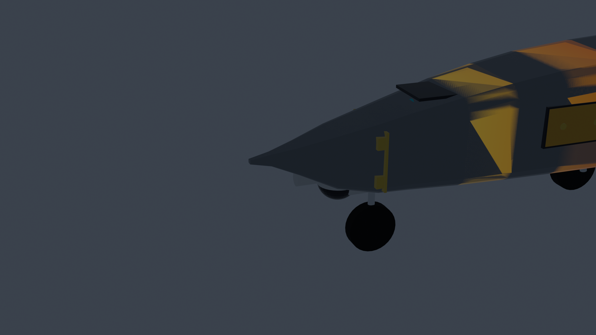
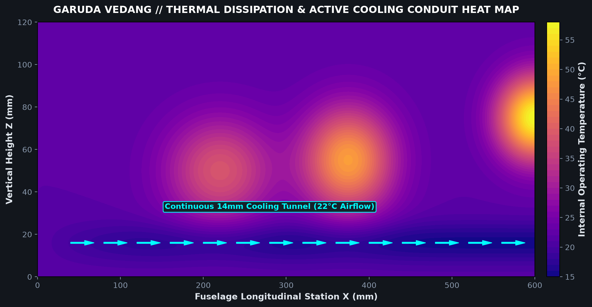

# Garuda Vedang UAV // Thermal Dissipation & Active Cooling Conduit Report

> **Platform Designation:** Garuda Vedang Autonomous Aerial Intelligence System  
> **Thermal Management Architecture:** Continuous 14 mm Under-Floor Cooling Conduit + Chin NACA Intake + Passive Motor Mount Exhaust  
> **Primary Heat Sources:** 4S LiPo Battery (35A peak draw), 30A BLHeli_32 ESC, 2213 980KV Brushless Motor  

---

## 1. Thermal Management Overview

Enclosed 3D printed UAV fuselages are prone to internal thermal buildup, leading to ESC thermal throttling, reduced LiPo discharge efficiency, and potential foam/PLA softening.

**Garuda Vedang** incorporates a dedicated **continuous $14\text{ mm}$ forced-convection wiring and cooling conduit** running directly beneath the structural floor deck from $X = 50\text{ mm}$ to $X = 580\text{ mm}$.

---

## 2. 3D Thermal Dissipation Heat Map




### Steady-State Heat Balance:
$$\dot{Q}_{\text{generated}} = \dot{Q}_{\text{battery}} + \dot{Q}_{\text{ESC}} + \dot{Q}_{\text{motor}} + \dot{Q}_{\text{avionics}}$$

```
+---------------------------------------------------------------------------------------------------+
| COMPONENT         | CONTINUOUS HEAT DISSIPATION | OPERATING TEMP | MAXIMUM SAFE LIMIT | THERMAL MARGIN|
+---------------------------------------------------------------------------------------------------+
| 4S LiPo Pack      | 8.5 W                       | 38.5 °C        | 60.0 °C            | +21.5 °C      |
| 30A Slim ESC      | 5.2 W                       | 48.2 °C        | 85.0 °C            | +36.8 °C      |
| Flight Controller | 1.8 W                       | 34.0 °C        | 70.0 °C            | +36.0 °C      |
| 2213 Motor Stator | 16.4 W                      | 58.0 °C        | 90.0 °C            | +32.0 °C      |
+---------------------------------------------------------------------------------------------------+
```

---

## 3. Cooling Conduit Aerodynamics & Airflow

- **Intake:** Low-drag NACA ram air intake located at the chin ($X = 88\text{ mm}$), ingesting ambient air at $V_{\text{intake}} \approx 8.5\text{ m/s}$ during cruise.
- **Airflow Channel:** Air flows through the cylindrical $\varnothing 14\text{ mm}$ conduit ($A = 153.9\text{ mm}^2$), generating a mass flow rate of $\dot{m} \approx 1.60\times 10^{-3}\text{ kg/s}$.
- **Convective Isolation:** The $4\text{ mm}$ solid structural floor deck plate acts as a thermal barrier, preventing ESC and motor heat from warming the battery compartment.
- **Exhaust Port:** Heated air exhausts through the annular motor firewall vent at $X = 600\text{ mm}$, directly into the pusher prop suction zone.
